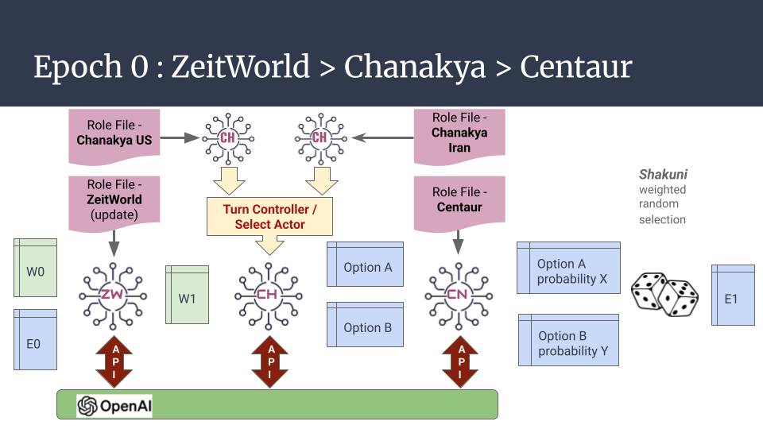

# Centaur — Monte Carlo++

**From AI-assisted decision-making to probabilistic simulation of alternative futures.**

## Enter the Centaur

Centaur began as an LLM-based framework for adjudicating strategic decisions in geopolitical classroom games.

It has since evolved into **Monte Carlo++ (MC++)**, a platform that combines traditional Monte Carlo sampling with LLM-based strategic reasoning.

Traditional Monte Carlo explores uncertainty using predefined mathematical models and probability distributions.

**Monte Carlo++ explores strategic uncertainty where decisions depend on context, competing interests and an evolving world.**

## How It Works

Five components work together:

- **ZeitWorld** — Maintains and updates the state of the world.
- **Chanakya** — Generates strategic alternatives for competing actors.
- **Centaur** — Evaluates alternatives and assigns probability weights.
- **Shakuni** — Selects an action through stochastic sampling.
- **Analyst** — Interprets patterns across multiple simulated histories.

Each simulation proceeds through successive epochs, where actions change the world and influence subsequent decisions.

**One run produces one possible history. Multiple runs produce an ensemble of alternative histories.**

**

## Middle East Oil Security (MOS)

The first implementation of MC++ simulates a US–Iran geopolitical crisis involving oil security in the Persian Gulf.

An experiment with **40 simulations for each of two alternative triggers** produced the following results:

| Outcome | Iran Closes Hormuz | US Offers De-escalation |
|---|---:|---:|
| Escalation | 36 (90%) | 2 (5%) |
| Stalemate | 3 (7.5%) | 18 (45%) |
| De-escalation | 1 (2.5%) | 20 (50%) |
| **Total** | **40** | **40** |

These are simulated outcomes, not real-world forecasts. They illustrate how different initial triggers can lead to markedly different distributions of alternative histories.

## What It Is — and Is Not

Monte Carlo++ is an experimental platform for exploring strategic possibilities, **not a prediction engine**.

Its LLM-generated probabilities are subjective assessments, not empirically validated forecasts.

## Documentation

- [Original Centaur Architecture](README_OLD.md)
- [Monte Carlo++ — Architecture and Methodology](Documentation/MCplus_Explanations.md)
- [Alpha Centaur — Original Prototype](Alpha_Centaur.ipynb)

## The Bottom Line

**Traditional Monte Carlo quantifies numerical uncertainty.**

**Monte Carlo++ explores strategic possibilities through stochastic sampling and LLM-based reasoning.**

*Manav Niti, Yantra Shakti.*

# Centaur

